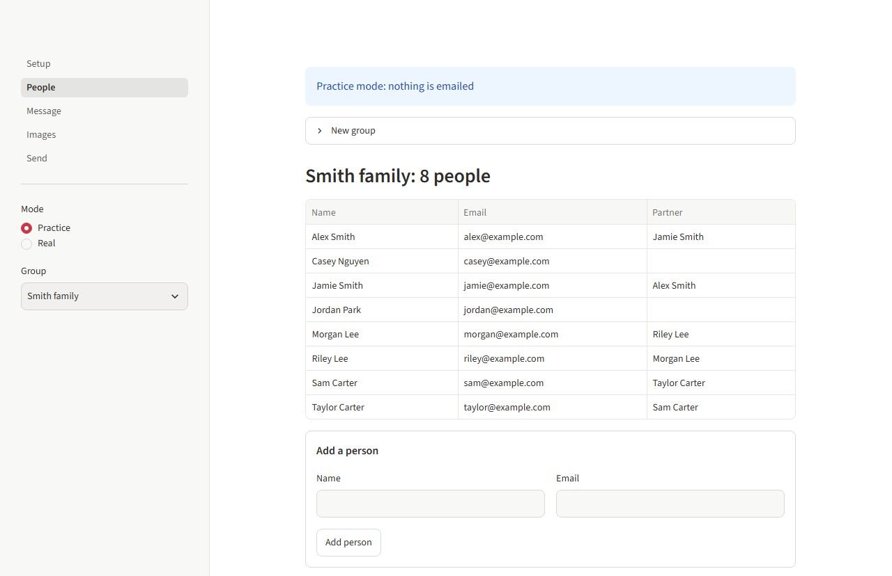
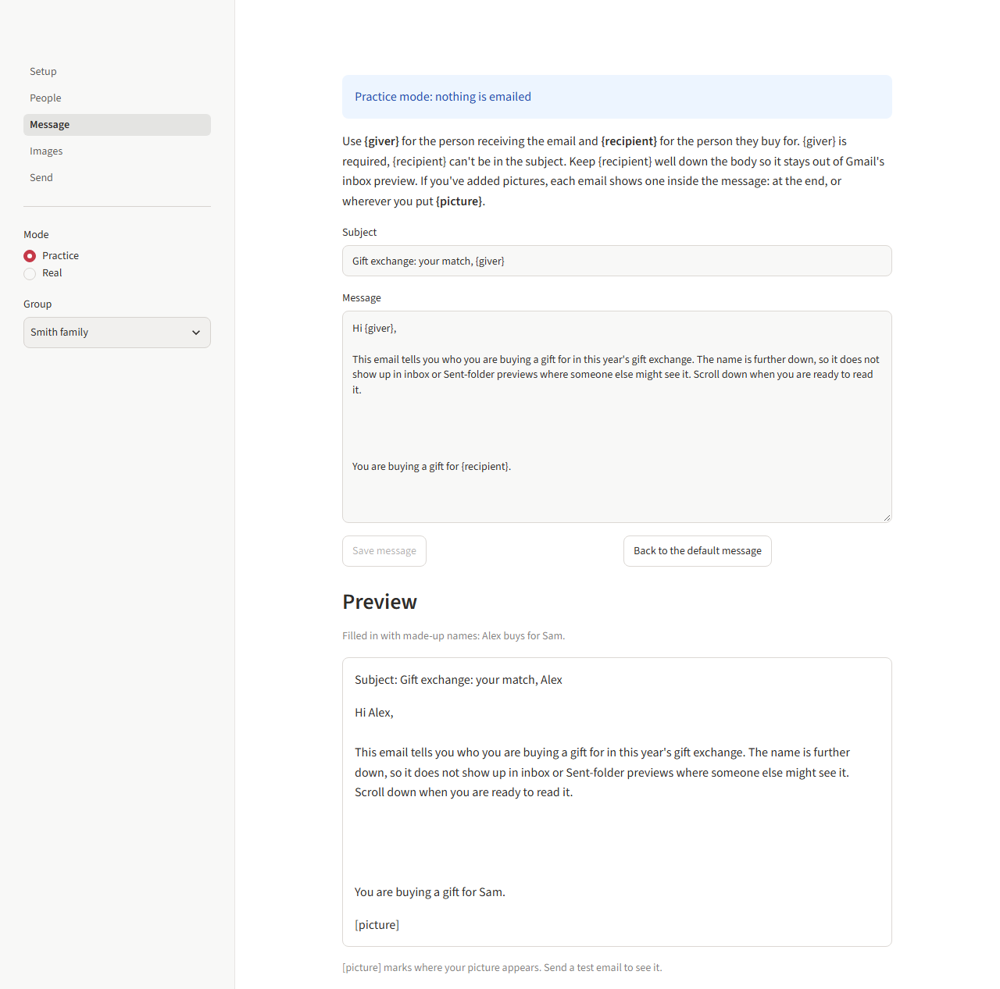
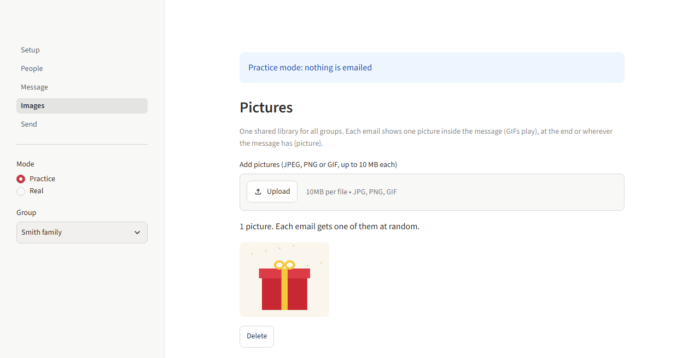
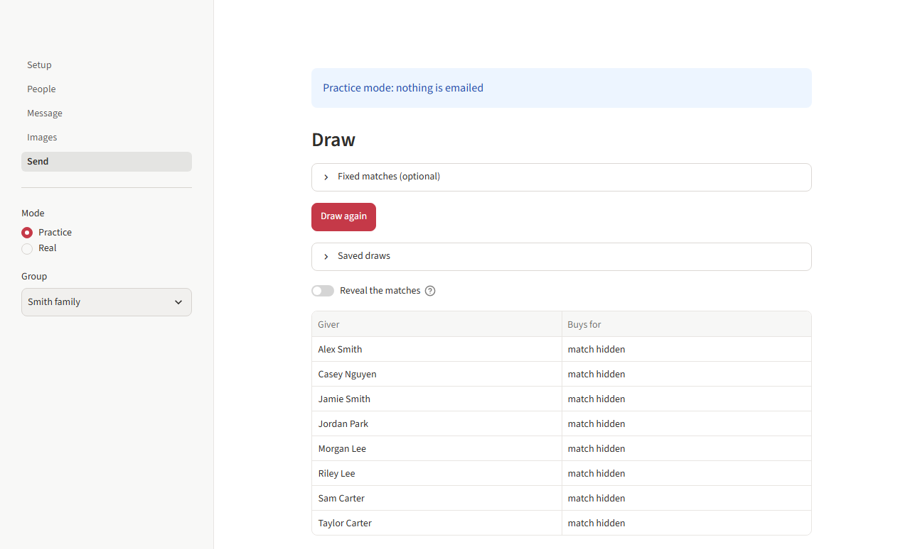
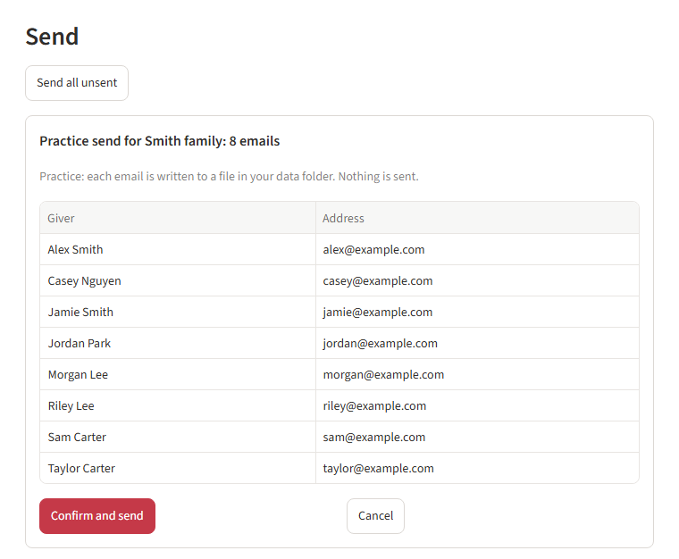
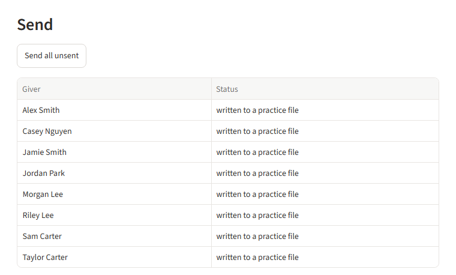
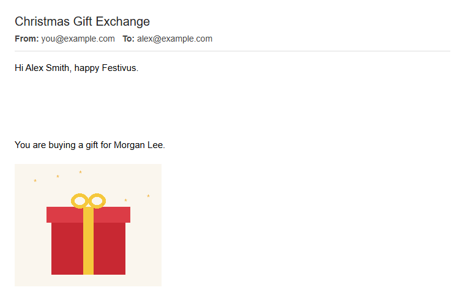
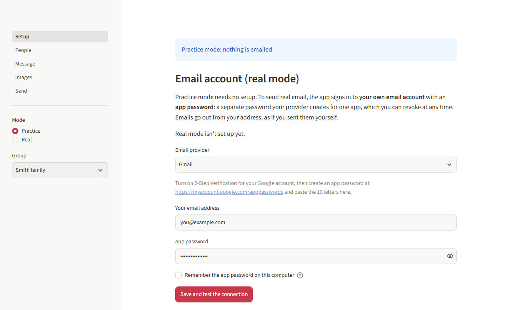
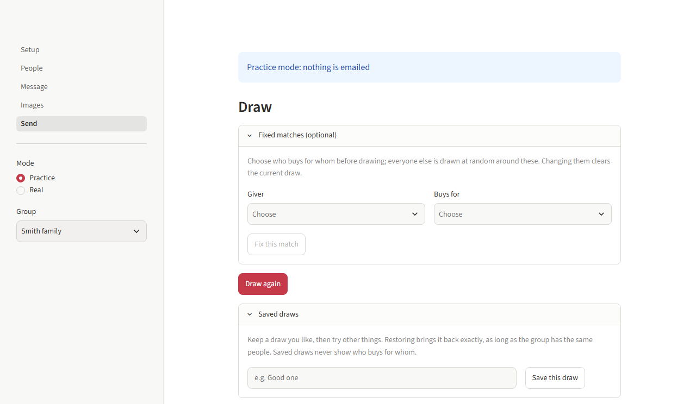

# Gift Exchange

A small app that runs a family gift exchange on your own computer: enter the people, mark couples, draw
who buys for whom (the matches stay hidden, even from you), and email everyone their match, with a GIF
if you like.

It runs on **Windows, macOS and Linux**. You don't need to install anything first: the first start sets
up everything it needs.

**What you need:** a computer with an internet connection (for the first start and for sending), and
for real email a Gmail account (or iCloud/Yahoo, or any provider that offers SMTP and app passwords).

## 1. Get the app

**Easiest (no tools needed):**

1. On the [GitHub page](https://github.com/phcombs/Gift-Exchange), click the green **Code** button, then
   **Download ZIP**.
2. Unzip it. Windows: right-click the zip → **Extract All** → **Extract**. Mac: double-click the zip.
3. The unzipped folder is called **Gift-Exchange-master**. Move it somewhere you'll keep it, such as
   your Documents folder, and rename it if you like. The app runs from this folder, and the shortcut it
   makes points here.

**With git:**

```text
git clone https://github.com/phcombs/Gift-Exchange.git
cd Gift-Exchange
```

## 2. Start it

Open the app folder (**Gift-Exchange-master** from the ZIP, or **Gift-Exchange** from git) and:

| System | How |
|---|---|
| **Windows** | Double-click **`run.cmd`** |
| **macOS** | Double-click **`run`**, or in Terminal type `./run` |
| **Linux** | In a terminal in the folder, type `./run` |

A terminal window opens and shows progress, then your browser opens the app at
<http://localhost:8501>. Keep the terminal window open while you use the app.

**The first start** sets up what the app needs, once: a small tool called
[uv](https://docs.astral.sh/uv/), Python 3.12 (just for this app) and the app's packages. It needs an
internet connection and takes a minute or two. Later starts take a few seconds. Nothing is installed
system-wide and no admin rights are needed.

**A shortcut** called **Gift Exchange** is added the first time the app starts: on your desktop and in
the Start menu (Windows), on your desktop (Mac), or in your applications menu (Linux). Use it to start
the app from then on. If you delete the shortcut it isn't added back; if you move the app folder, the
next start from the folder updates it.

**To stop the app,** close the terminal window (or press **Ctrl+C** in it). Your groups, people and
settings are kept for next time.

If your computer warns you the first time:

- **Windows** ("Windows protected your PC"): click **More info**, then **Run anyway**. This appears
  because the file came from the internet; it's a plain text script you can open in Notepad to read.
- **macOS** ("can't be opened because it is from an unidentified developer"): right-click `run`, choose
  **Open**, then **Open** again. If it opens as text instead, open Terminal, type `cd ` (with a space),
  drag the app folder into the window, press Enter, then type `sh run` and press Enter.

## 3. Run your exchange

The app starts in **Practice** mode (switch in the left sidebar): emails are written to files on your
computer instead of being sent, so you can try everything safely.

### People

Create a group, then add people one at a time, or paste a list with one `name, email` per line. Mark
couples; they never draw each other. You can have several groups (for example, two sides of the
family); pick the group in the sidebar.



### Message

Edit the subject and message. `{giver}` becomes the person reading the email and `{recipient}` the
person they buy for. Keep `{recipient}` well down the message so it doesn't show in the inbox preview.
The preview below the editor uses made-up names (Alex and Sam), and **Send test email** sends you a copy.



### Images (optional)

Add a GIF or picture. Each email shows one inside the message; with several, everyone gets a different
one while they last. It goes at the end of the message, or wherever you type `{picture}`.



### Send

Press **Draw**. Everyone is listed with "match hidden": the app never shows who buys for whom unless you
turn on **Reveal the matches**. (**Fixed matches** and **Saved draws** are optional; see
[More features](#more-features).)



Press **Send all unsent**. A confirm step lists who gets an email and at which address (never their
match). Press **Confirm and send**.



The table then shows each person's status. In Practice mode nothing is sent: a green message at the
top of the page names the folder the email files went into. Double-click one to open it in your mail
app and see exactly what that person would get.



### What people receive

Each person gets their own email, from your address, with their match and the picture:



When everything looks right, set up Gmail (next section), switch the sidebar to **Real**, and send.

## 4. Send real email from Gmail

The app sends from your own Gmail account using an **app password**: a separate 16-letter password that
Google makes for one app. It can be revoked at any time and your normal password is never used. You
don't need a developer account or a Google Cloud project.

1. **Turn on 2-Step Verification** for your Google account, if it isn't on yet:
   <https://myaccount.google.com/signinoptions/twosv>. App passwords only exist once this is on.
2. **Create an app password** at <https://myaccount.google.com/apppasswords>. Type a name such as
   "Gift Exchange" and click **Create**. Google shows 16 letters once; copy them.
3. **In the app**, open the **Setup** page. Choose **Gmail**, enter your Gmail address, paste the app
   password (spaces don't matter), and press **Save and test the connection**. It signs in once to
   check, and says "Real mode is ready" when it works.
   - Tick **Remember the app password on this computer** if you don't want to enter it each time you
     start the app. Otherwise it's forgotten when the app stops.

   

4. **Send yourself a test:** switch the sidebar to **Real**, go to the **Message** page, type your own
   address in **Send test to**, and press **Send test email**. Check your inbox.
5. **Send everyone their match:** on the **Send** page in Real mode, press **Send all unsent** and
   confirm. Each person's status shows in the table.

If the app passwords page says the setting isn't available: 2-Step Verification is off, or the account
is a work/school account (those may not allow app passwords), or it uses Advanced Protection.

**Other providers:** iCloud Mail and Yahoo Mail work the same way with their own app passwords (choose
them on the Setup page). For anything else, choose **Other** and enter the SMTP server, port and
security from your provider's help pages.

**To stop using it:** press **Forget this account** on the Setup page, and delete the app password at
<https://myaccount.google.com/apppasswords>.

Good to know:

- If an email fails, the run stops there. Press **Send all unsent** again to continue. Nobody gets two
  emails unless you press **Send again** for them.
- Your Gmail **Sent** folder holds every email, including the matches. The default message keeps the
  match out of the inbox preview line, but opening a sent email shows it.
- Once real sending starts, the draw is locked: only email addresses can change. **Start a new
  exchange** on the Send page clears the draw for next year and keeps the people and the message.

## More features

- **Pictures:** JPEG, PNG or GIF up to 10 MB each (animated GIFs play in Gmail). With several, everyone
  gets a different one while they last; with one, everyone gets that one. It appears at the end of the
  message, or wherever you type `{picture}`. With no pictures, emails are plain text.
- **Reveal:** the matches stay hidden, since the organizer is usually in the draw. To see them, turn on
  **Reveal the matches** on the Send page. It's off again in every new tab.
- **Changing a match:** with Reveal on, **Change a match** gives someone a different person (the two
  people involved swap). This works until real emails start going out.
- **Fixed matches:** on the Send page, open **Fixed matches** before drawing to choose who buys for whom
  for anyone you like; everyone else is drawn at random around them.
- **Saved draws:** found a draw you like but want to try other things? Open **Saved draws**, name it and
  save it. **Restore** brings it back exactly, as long as the group has the same people.

The Send page with **Fixed matches** and **Saved draws** opened:



## Your data

Names, addresses, draws and email settings stay on your computer, outside the app folder, never in git:

| System | Folder |
|---|---|
| Windows | `%APPDATA%\Gift Exchange` (paste into File Explorer's address bar) |
| macOS | `~/Library/Application Support/Gift Exchange` |
| Linux | `~/.local/share/gift-exchange` |

Everything is in one file, `giftx.sqlite3`; back it up by copying it. Practice emails are in the
`practice` folder next to it. Set the `GIFTX_DATA_DIR` environment variable to use another folder.

**Updating:** download the new ZIP, replace the old app folder with the new one (same place), and start
it the same way; or run `git pull` in the folder. Your data is kept, because it lives outside the app
folder.

**Removing it:**

1. Delete the app folder, the data folder above, and the **Gift Exchange** shortcut.
2. Delete the app password at <https://myaccount.google.com/apppasswords>.
3. Optionally remove uv too: first run `uv cache clean` in a terminal to delete its downloads (including
   Python 3.12), then delete `uv.exe`, `uvx.exe` and `uvw.exe` from `%USERPROFILE%\.local\bin`
   (Windows), or `uv` and `uvx` from `~/.local/bin` (Mac/Linux).

## Troubleshooting

- **The browser didn't open:** go to <http://localhost:8501> yourself.
- **"The app is already running"**: it's open in another window; the browser tab opens again.
- **The shortcut does nothing or points to the wrong place:** start once from the app folder
  (`run.cmd` or `run`); that updates the shortcut.
- **The terminal window closed right away (Windows):** start `run.cmd` from a terminal to see the
  message, or check your internet connection for the first start.
- **"The server refused the sign-in"**: use the app password, not your normal password, and check that
  2-Step Verification is on.
- **A person shows "may or may not have gone"**: the connection broke mid-send. Look in your Sent
  folder, then press **It went** or **Send again** for that person on the Send page.
- **"The picture for … is missing"**: a picture was deleted outside the app after emails were prepared.
  Run practice again, or **Start a new exchange** before real sending begins.
- The app only listens on your own computer (`localhost`); other devices on your Wi-Fi can't open it.

## For developers

- Run the tests with `uv run --frozen pytest -q` (or `sh .team/check.sh`); start with `python run.py`.
- `GIFTX_NO_OPEN=1` skips opening the browser, `GIFTX_NO_SHORTCUT=1` skips the shortcut, and
  `GIFTX_DATA_DIR` moves the data folder.
- Code: `src/giftx/` (Streamlit pages in `ui/`, SQLite in `storage.py`, the draw in `draw.py`, sending in
  `pipeline.py` and `senders.py`). The launcher is `run.py` (standard library only), wrapped by `run`
  and `run.cmd`.
- The design is in `docs/designs/design_draft.md`; `HANDOFF.md` has the current status.
- Screenshots: `uv run --group docs playwright install chromium` once, then
  `uv run --group docs python scripts/screenshots.py` regenerates everything in `docs/screenshots/`
  from a throwaway copy of the app filled with made-up people.

---

*That rug tied the room together.*
